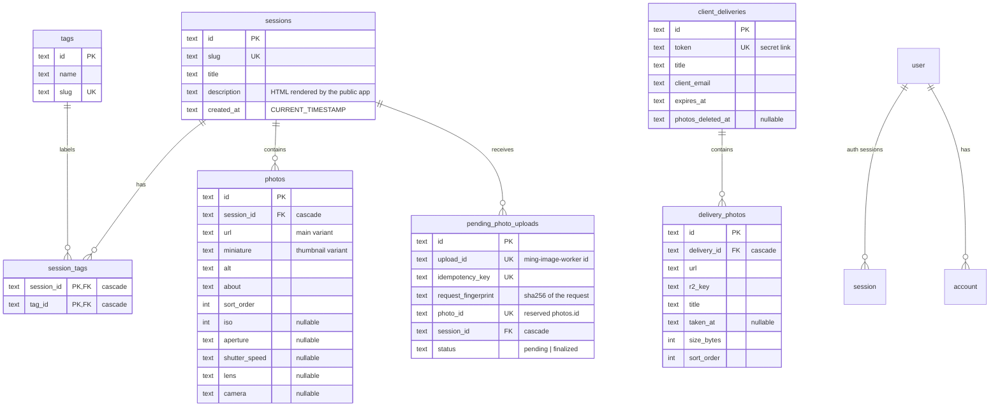

# RoncalPhoto

Portfolio for a professional photographer: a public gallery, a private admin dashboard and a
type-safe API, all on Cloudflare Workers. Bun + Turborepo monorepo.

The API is a tRPC router. Its TypeScript type (`AppRouter`) is the only contract between server and
clients: inputs are Zod schemas on the server, outputs are whatever the server functions return, and
both frontends consume them through `@trpc/tanstack-react-query` without hand-written DTOs. Rename a
column or change a return value and the type-checker points at every screen that breaks.

- [Quick start](#quick-start)
- [Repository layout](#repository-layout)
- [Architecture](#architecture)
- [Data model](#data-model)
- [API reference](#api-reference)
- [Flows](#flows)
- [Configuration](#configuration)
- [Database migrations](#database-migrations)
- [Deployment](#deployment)
- [Quality gates and testing](#quality-gates-and-testing)
- [How to add things](#how-to-add-things)
- [Review changelog (2026-10-14)](#review-changelog-2026-10-14)
- [Known gaps](#known-gaps)

---

## Quick start

```bash
# @jmurga97/components comes from GitHub Packages (.npmrc reads the token from the env)
export NPM_TOKEN=<GitHub token with read:packages>
bun install

cp apps/api/.dev.vars.example apps/api/.dev.vars   # then set BETTER_AUTH_SECRET

# Safe local mode: Miniflare D1 with seed data, nothing remote
bun run db:seed:local                               # local migrations + apps/api/seed/seed-local.sql
bun run dev:local                                   # api :8787, admin :5173, photos :5174

# Production data mode
bun run dev                                         # same ports, remote bindings
```

**`bun run dev:local`** runs the API with `wrangler dev --env local` (`[env.local]` in
`apps/api/wrangler.toml`): D1 is a local Miniflare database under `apps/api/.wrangler/state`, and the
email/image workers are local bindings that are not running. Seed content:

- Admin login: `juanmurga97@gmail.com` with OTP **`000000`** (`DEV_FIXED_OTP`, no email is sent).
- 4 tags, 3 sessions (`costa-norte`, `retratos-de-estudio`, `ciudad-de-noche`) with picsum photos.
- Client delivery: <http://localhost:5174/delivery/seed-delivery-token>.

Photo uploads need `ming-image-worker` and fail locally. `bun run db:seed:local` is re-runnable: it
resets the seed rows and keeps anything else. Delete `apps/api/.wrangler/state` to start from zero.

**`bun run dev`** runs `wrangler dev` with **remote** bindings (`remote = true` in
`apps/api/wrangler.toml`): the local Worker reads and writes the production D1 database and calls
the real `ming-email-worker` / `ming-image-worker`. Be deliberate with writes.

Admin login is email OTP with sign-up disabled: the user must already exist in the Better Auth
`user` table.

| Command                                  | What it does                                                              |
| ---------------------------------------- | ------------------------------------------------------------------------- |
| `bun run dev`                            | All apps in watch mode (Turborepo), API on production bindings.           |
| `bun run dev:local`                      | All apps in watch mode, API on the local D1 (`wrangler dev --env local`). |
| `bun run build`                          | Builds every app (`wrangler types` + `tsc` for the API, Vite for SPAs).   |
| `bun run check`                          | Type-checks every workspace + verifies the Drizzle schema vs. migrations. |
| `bun run lint` / `lint:fix`              | Oxfmt + Oxlint (type-aware, zero warnings, layer boundaries).             |
| `bun run test:e2e`                       | Playwright suite for the admin, against a mocked tRPC API.                |
| `bun run db:generate -- --name <change>` | Generates a migration from schema changes.                                |
| `bun run db:check`                       | Fails if the schema and the committed migrations diverge.                 |
| `bun run db:migrate:local`               | Applies migrations to the local D1 (Miniflare state, `--env local`).      |
| `bun run db:seed:local`                  | `db:migrate:local`, then loads `apps/api/seed/seed-local.sql`.            |
| `bun run --cwd apps/api deploy`          | Applies remote migrations, then deploys the API Worker.                   |

Bun is the only package manager (`packageManager: bun@1.3.6`).

---

## Repository layout

```text
roncalphoto/
├── apps/
│   ├── api/                      # Cloudflare Worker: tRPC + Better Auth over D1
│   │   ├── migrations/           # Drizzle Kit SQL + snapshots (applied by Wrangler)
│   │   ├── scripts/check-db-migrations.ts
│   │   ├── seed/seed-local.sql   # Local D1 seed (`bun run db:seed:local`)
│   │   ├── src/
│   │   │   ├── index.ts          # fetch entrypoint: /health, /api/auth/*, /trpc/*, CORS
│   │   │   ├── auth.ts           # Better Auth instance for this Worker
│   │   │   ├── config/env.ts     # Zod-validated bindings and vars
│   │   │   ├── http/cors.ts
│   │   │   ├── trpc/             # context, procedures, root router (AppRouter)
│   │   │   ├── shared/           # error mapping, inputs shared by modules
│   │   │   └── modules/<domain>/ # <domain>.router.ts, <domain>.service.ts, <domain>-input.schema.ts
│   │   └── wrangler.toml
│   ├── photos/                   # Public gallery SPA (static-assets Worker)
│   └── photos-admin/             # Admin dashboard SPA (static-assets Worker)
├── packages/
│   ├── db/                       # @roncal/db: Drizzle schema, repositories, row→domain mappers
│   ├── auth/                     # @roncal/auth: Better Auth factory + React OTP client
│   └── ui/                       # @roncal/ui: QueryClient factory, SuspenseWrapper
├── e2e/                          # Playwright specs + tRPC fixtures for the admin
├── docs/                         # Ops notes (Cloudflare, auth, email worker) + architecture series
├── .oxlintrc.jsonc               # Oxlint rules, including architecture boundaries
├── .oxfmtrc.jsonc                # Oxfmt configuration (120 columns)
└── turbo.json
```

Packages are consumed as TypeScript source (no build step). Frontend path aliases: `@`, `@app`,
`@components`, `@lib`, `@pages` (admin), `@utils`.

---

## Architecture

### Big picture

```text
 apps/photos (public)          apps/photos-admin (auth)
   trpc.x.queryOptions()          trpc.x.queryOptions() / mutationOptions()
          │  credentials: omit           │  credentials: include (session cookie)
          └──────────────┬───────────────┘
                         ▼
             apps/api  (Cloudflare Worker, fetch)
   /health ─ /api/auth/* (Better Auth) ─ /trpc/* (fetchRequestHandler)
                         │
           router ──► service ──► @roncal/db repository ──► D1 (SQLite)
                         │
                         ├── IMAGE_WORKER (ming-image-worker, RPC: createUpload/getUpload/retryUpload)
                         └── EMAIL_WORKER (ming-email-worker, fetch: OTP emails)
```

External services are separate repositories reached through Cloudflare service bindings:
`ming-email-worker` sends the OTP emails; `ming-image-worker` signs R2 uploads and produces the
`main` (1920 px WebP) and `thumbnail` (480 px WebP) variants for the `roncalphoto-portfolio` preset.

### End-to-end type safety

```text
packages/db/src/schema/*.ts       table definitions (camelCase TS keys, snake_case SQL columns)
        │ $inferSelect
packages/db/src/mappers.ts        toPhoto / toSessionSummary / toSession / toDelivery → non-nullable domain shapes
        │ returned by repositories → services → procedures
apps/api/src/trpc/router.ts       AppRouter plus inputs and outputs inferred from its procedures
        │ import type (no runtime code crosses the boundary)
apps/*/src/lib/api/client.ts      createTRPCOptionsProxy<AppRouter>() → trpc.sessions.get.queryOptions(...)
```

- Inputs are validated once, on the server, by the procedure's Zod schema; the client sees the
  schema's input type.
- Outputs are inferred from the mapper return types. D1 `NULL`s are normalised in
  `packages/db/src/mappers.ts` (e.g. missing `iso` → `0`, missing `lens` → `""`), so clients never
  deal with nullable domain fields.
- Query keys come from the tRPC proxy (`trpc.sessions.get.queryKey({ slug })`), so loaders, hooks,
  `setQueryData` and invalidation always agree.

### API Worker (`apps/api`)

**Entry (`src/index.ts`).** Parses the environment, answers `OPTIONS` preflights, then dispatches:
`GET /health`, `/api/auth/*` to Better Auth, `/trpc/*` to tRPC, anything else 404. Every response
goes through `withCors`; tRPC responses get `Cache-Control: no-store` because they may depend on
the session cookie. Unexpected exceptions become a JSON 500 with CORS headers so the browser can
read them.

**Environment (`src/config/env.ts`).** One Zod schema validates bindings (`DB_RONCALPHOTO`,
`IMAGE_WORKER`, `EMAIL_WORKER`) and vars. `ALLOWED_ORIGINS` is split into an array once.

**CORS (`src/http/cors.ts`).** Production reflects only origins in `ALLOWED_ORIGINS`; any other
environment reflects any origin (Vite ports, Playwright, phones on the LAN). Credentials are allowed
because the admin authenticates with a cookie.

**Auth (`src/auth.ts` + `packages/auth`).** Better Auth with the Drizzle adapter on the same D1,
email-OTP plugin (6 digits, 5 min, 3 attempts, hashed, sign-up disabled), 7-day sessions.
`trustedOrigins` = `ALLOWED_ORIGINS`. In production the admin and API are on different sites, so
cookies are `SameSite=None; Secure; Partitioned`.

**tRPC (`src/trpc/`).**

- `context.ts`: per request, a Drizzle client plus `getSession()`, which is lazy (public calls
  never touch auth) and memoised (a batch of protected calls does one lookup).
- `trpc.ts`: `publicProcedure` maps unexpected errors to typed ones through
  `shared/errors.ts#toRpcError`: D1 `FOREIGN KEY` violations become `BAD_REQUEST`, `UNIQUE`
  violations become `CONFLICT`, anything else stays `INTERNAL_SERVER_ERROR` (and is logged).
  `protectedProcedure` adds `UNAUTHORIZED` when there is no session and puts `session` in `ctx`.
- `router.ts`: mounts the modules and exports `AppRouter` (published as `@roncal/api/router`,
  type-only for clients).

**Modules (`src/modules/<domain>/`).** Each domain has:

| File                       | Responsibility                                                       |
| -------------------------- | -------------------------------------------------------------------- |
| `<domain>.router.ts`       | Procedures: access level, input schema, delegate to the service.     |
| `<domain>-input.schema.ts` | Zod inputs + inferred input types (only when the module needs them). |
| `<domain>.service.ts`      | Business rules (slugs, idempotency, not-found) over repositories.    |

Domains: `sessions`, `photos`, `tags`, `photo-uploads` (+ `image-worker.client.ts`),
`client-deliveries`. Services are plain functions taking `db` first (`getSession(db, slug)`);
repositories are imported as namespaces (`sessionsRepository.findBySlug(db, slug)`).
`shared/input.schema.ts` holds inputs used by several modules (`idInput`, `slugInput`,
`photoContentInput`).

Integrity is delegated to the database where possible: unknown tag ids or session ids are rejected
by foreign keys (inside an atomic `db.batch()`), duplicate slugs by a unique index. The service
layer only adds rules SQL cannot express (slug generation, idempotency fingerprints, finalize-once).

**Layer rules (Oxlint, errors not warnings).**

- `router → service → @roncal/db repository → D1`. Routers cannot import `@roncal/db` or
  `drizzle-orm`; modules cannot import `drizzle-orm` or `@roncal/db/schema`.
- Modules never import each other. Cross-domain reads go through repositories (e.g. `tags.get`
  uses `sessionsRepository.list(db, { tagId })`).
- `config/` cannot import modules or tRPC; `shared/` cannot import modules or tRPC.
- `packages/db` cannot import apps or `@roncal/api/router`.

### Persistence package (`packages/db`)

- `client.ts`: `createDb(d1)` → Drizzle client with the full schema (enables `db.query.*`).
- `schema/`: `portfolio.ts` (tags, sessions, session_tags, photos), `photo-uploads.ts`,
  `client-deliveries.ts`, `auth.ts` (Better Auth). `schema/index.ts` is the only Drizzle Kit entry.
- `repositories/*.repository.ts`: all SQL. Plain functions, `db` first. Reads that need relations use
  Drizzle relational queries (`db.query.sessions.findMany({ with: { photos, sessionTags: { with:
{ tag } } } })`); writes that touch several tables use `db.batch()` (atomic on D1). Writes return
  rows with `.returning()` instead of re-reading.
- `mappers.ts`: row → domain shape, plus the domain types (`Photo`, `Session`, `Tag`, `Delivery`).

### Frontends

Both SPAs share the same skeleton: TanStack Router (file routes in `src/app/routes`, generated tree
in `src/app/route-tree.gen.ts`), TanStack Query for server state, Zustand for UI state, Tailwind 4.
Import layers are enforced: `utils → lib → components → pages` (lower layers never import upper
ones).

**Data access pattern.**

```ts
// route: prefetch in the loader
loader: ({ context, params }) =>
  context.queryClient.ensureQueryData(trpc.sessions.get.queryOptions({ slug: params.slug })),

// component: read from the same cache entry (suspends only on a cold cache)
const { data: session } = useSuspenseQuery(trpc.sessions.get.queryOptions({ slug }));

// admin mutation
const update = useMutation(trpc.sessions.update.mutationOptions());
await update.mutateAsync({ slug, data });
await invalidatePortfolio(); // sessions, photos and tags reference each other
```

- `lib/api/client.ts` in each app creates the tRPC client and the options proxy. The API origin is
  `VITE_API_URL`, else `http://localhost:8787` under `vite dev`, else the API Worker hostname for the public site (`https://roncalphoto-api.murgapja-fee.workers.dev`)
  or `https://api.murga.ing` for the admin.
- The public app sends requests with `credentials: "omit"`; the admin with `"include"`.
- `@roncal/ui#createQueryClient`: `staleTime` 60 s, one retry, no refetch on focus/reconnect.
- Admin `invalidatePortfolio()` invalidates every tRPC query (`trpc.pathKey()`), after awaiting the
  mutation, then the editor seeds the detail cache with the returned record.

**Public app (`apps/photos`).** Routes: `/?photo=<id>&tag=<slug>` (canvas: pan/zoom wall of every
photo in a new random order per visit; `photo` opens that photo's session over it),
`/session/:slug?photo=<id>` (the same canvas with that session's stage open, at its first photo when
`photo` is omitted; opening any photo navigates here), `/delivery/:token` (client delivery with list
and gallery views and ZIP download via `client-zip`). Notable decisions:

- The canvas is rendered by the `/_app` layout route, not by its children, so moving between `/` and
  `/session/:slug` keeps the same wall instead of remounting it.
- The edge Worker (`apps/photos/worker`) server-renders `/` and `/session/:slug` for crawlers
  (title, description, canonical, Open Graph image, JSON-LD and a static photo list). Unknown or
  empty sessions return 404. `/sitemap.xml` lists the home page and every session with its images
  (`/image-sitemap.xml` 301s there).

- The canvas camera is clamped to the wall (`constrainCamera`), starts at a readable overview scale
  and has a "Vista general" reset.
- Clicking a photo opens a session stage over the canvas: the shared `GalleryView` (CSS scroll-snap
  plus an `IntersectionObserver`, keeping scroll, keyboard and `?photo=` in sync) positioned on that
  photo, next to a full-height panel with session (title, tags, description) and photo info. The
  tile and the slide share the `photo-focus` view-transition name so the photo morphs between them.
- The sidebar is a floating glass card anchored to a pill (top-left on desktop, bottom sheet on
  mobile), with independent desktop/mobile open flags. It lists sessions, a tag filter and about;
  hovering a session dims the other photos, clicking it opens that session at its first photo.
  Layout is fixed to `100vh`.
- The theme follows `prefers-color-scheme` unless set with Cmd/Ctrl+1 (light) or Cmd/Ctrl+2 (dark);
  `index.html` applies it before React mounts (no theme flash).
- View-model hooks (`use-*-view-model.ts`) adapt API shapes to component props.

**Admin (`apps/photos-admin`).** Routes under the `_auth` layout require a Better Auth session
(`beforeLoad` redirects to `/login`). Screens: overview, sessions (list/create/edit), photos
(list with bulk assign/delete, edit), tags (read-only list/detail), deliveries (mock data, see
[Known gaps](#known-gaps)), batch upload preview. UI comes from `@jmurga97/components` (Ming design
system, React), with self-hosted Geist fonts and a persisted light/dark switch. Forms are React Hook
Form + Zod with small adapters in `components/forms/adapters`; `resource-editor-helpers.tsx`
centralises editor status, server-error display, delete confirmation and submit handling.

---

## Data model



Notes:

- **Session** is the central entity (a shoot/gallery), addressed publicly by `slug`. It has 1..n
  tags (enforced at the API: `tagIds` must be non-empty) and 0..n photos ordered by `sort_order`.
- `pending_photo_uploads` also stores the photo copy and metadata (`alt`, `about`, `sort_order`,
  `iso`…) captured when the upload starts; it becomes a `photos` row when processing succeeds.
- Deliveries are written outside this repo (no create endpoint yet); the API only reads them.
  `photos_deleted_at` set means the originals were purged: the API returns `photosAvailable: false`.
- Auth tables (`user`, `session`, `account`, `verification`) belong to Better Auth.
- `photo_upload_jobs` (not drawn) is legacy: only the retired `roncalphoto-image-optimizer` Worker
  wrote it and no code in this repo reads it.
- Indexes: unique slug/token/idempotency/upload ids, `idx_sessions_created_at`,
  `idx_session_tags_tag`, `idx_photos_sort (session_id, sort_order)`, FK indexes on child tables.
- Timestamps are SQLite `CURRENT_TIMESTAMP` text (UTC, `YYYY-MM-DD HH:MM:SS`).

Domain shapes returned by the API (from `packages/db/src/mappers.ts`):

```ts
type Tag = { id: string; name: string; slug: string };
type PhotoMetadata = {
  iso: number;
  aperture: string;
  shutterSpeed: string;
  lens: string;
  camera: string;
};
type Photo = {
  id;
  sessionId;
  url;
  miniature;
  alt;
  about;
  sortOrder: number;
  metadata: PhotoMetadata;
};
type SessionSummary = {
  id;
  slug;
  title;
  description;
  createdAt: string;
  tags: Tag[];
  photoCount: number;
  firstPhotoId?: string;
};
type Session = SessionSummary & { photos: Photo[] };
type Delivery = {
  id;
  token;
  title;
  photosAvailable: boolean;
  photos: { id; url; title; takenAt: string; sizeBytes: number; sortOrder: number }[];
};
```

---

## API reference

All procedures live under `/trpc` (HTTP batching enabled, no transformer: plain JSON).

| Procedure              | Access    | Input                                                                                                          | Output                                                                       |
| ---------------------- | --------- | -------------------------------------------------------------------------------------------------------------- | ---------------------------------------------------------------------------- |
| `sessions.list`        | public    | —                                                                                                              | `SessionSummary[]` (newest first, no photo payloads)                         |
| `sessions.canvas`      | public    | —                                                                                                              | `Session[]` (photos for the public canvas)                                   |
| `sessions.get`         | public    | `{ slug }`                                                                                                     | `Session` · `NOT_FOUND`                                                      |
| `sessions.create`      | protected | `{ title, description, tagIds[], slug? }`                                                                      | `Session`                                                                    |
| `sessions.update`      | protected | `{ slug, data: Partial<create input> }`                                                                        | `Session` (may have a new slug)                                              |
| `sessions.delete`      | protected | `{ slug }`                                                                                                     | `{ id }` (photos/tags links cascade)                                         |
| `photos.list`          | public    | `{ limit?, offset?, search? }` (limit ≤ 100, search ≤ 200 chars)                                               | `{ items: Photo[], total }`                                                  |
| `photos.get`           | public    | `{ id }`                                                                                                       | `Photo`                                                                      |
| `photos.update`        | protected | `{ id, data: Partial<{ sessionId, url, miniature, alt, about, sortOrder, metadata }> }`                        | `Photo`                                                                      |
| `photos.delete`        | protected | `{ id }`                                                                                                       | `{ id }`                                                                     |
| `tags.list`            | public    | —                                                                                                              | `Tag[]` (by name)                                                            |
| `tags.get`             | public    | `{ slug }`                                                                                                     | `{ tag, sessions: SessionSummary[] }`                                        |
| `photoUploads.create`  | protected | `{ idempotencyKey, data: { sessionId, alt, about, sortOrder?, metadata?, filename, contentType, sizeBytes } }` | `{ uploadId, photoId, status, upload: { url, expiresAt, headers } \| null }` |
| `photoUploads.get`     | protected | `{ uploadId }`                                                                                                 | `{ uploadId, photoId, status, error, photo: Photo \| null }`                 |
| `photoUploads.retry`   | protected | `{ uploadId }`                                                                                                 | same as `get`                                                                |
| `clientDeliveries.get` | public    | `{ token }`                                                                                                    | `Delivery`                                                                   |

Input rules worth knowing:

- Session titles are limited to 120 characters; descriptions and photo descriptions to 5,000;
  photo alt text to 200; tag names to 40.
- Session `slug` is optional: it is derived from the title (`"Atardecer en Ávila"` →
  `atardecer-en-avila`), and a taken slug gets a suffix (`-2`, `-3`…). Duplicate `tagIds` are
  removed.
- Photo metadata: `""` or `null` **clears** a field; omitting it leaves it unchanged. `iso` must be
  a positive integer or `null`.
- Uploads accept JPEG, PNG or WebP up to 25 MiB.

Errors are standard tRPC codes: `BAD_REQUEST` (validation, unknown referenced ids), `UNAUTHORIZED`,
`NOT_FOUND`, `CONFLICT` (unique violation, idempotency key reused with another payload),
`PAYLOAD_TOO_LARGE` / `UNSUPPORTED_MEDIA_TYPE` (from the image worker), `SERVICE_UNAVAILABLE` /
`BAD_GATEWAY` (image worker down or malformed).

Non-tRPC routes: `GET /health` → `{ "status": "ok" }`; `/api/auth/*` → Better Auth.

---

## Flows

### Photo upload

```mermaid
sequenceDiagram
  participant A as Admin (browser)
  participant API as roncalphoto-api
  participant IW as ming-image-worker
  participant R2
  A->>API: photoUploads.create({ idempotencyKey, data })
  API->>API: fingerprint = sha256(data); reject key reuse with another payload (CONFLICT)
  API->>API: insert pending_photo_uploads (reserves photoId; FK checks sessionId)
  API->>IW: createUpload({ productId: "roncalphoto", preset, externalId: photoId, file })
  IW-->>API: { uploadId, status, signed PUT url }
  API-->>A: { uploadId, photoId, upload }
  A->>R2: PUT original (signed URL + headers)
  R2-->>IW: object-create → queue → build main + thumbnail
  loop until succeeded / failed
    A->>API: photoUploads.get({ uploadId })
    API->>IW: getUpload
    API->>API: first "succeeded": batch(insert photos, mark pending finalized)
    API-->>A: { status, error, photo }
  end
```

Retrying `create` with the same key returns the same `photoId` (the worker is idempotent too), so a
flaky network never creates duplicates. Finalization happens once: if the photo is later deleted,
polling the old upload does not bring it back.

The admin batch upload screen (`/photos/new`) runs this flow sequentially for each selected file.
A session is required. The filename supplies the initial alt text and description; both can be edited
after upload. Failed files stay selected for retry with the same idempotency key and session, and
successful files are removed only after the API confirms the photo was saved.

### Admin authentication

1. `/login` calls `authClient.emailOtp.sendVerificationOtp({ email, type: "sign-in" })`.
2. The API's Better Auth stores a hashed OTP and sends it through `EMAIL_WORKER`
   (`POST https://email-worker.internal/send?productId=roncalphoto`, template `otp`). Unknown emails
   get no code (sign-up disabled) but the UI does not reveal it. With `DEV_FIXED_OTP=true` and
   `NODE_ENV` other than `production` (only `[env.local]`), the code is always `000000` and no email
   is sent.
3. `authClient.signIn.emailOtp({ email, otp })` sets the session cookie.
4. `_auth` routes call `authClient.getSession()` in `beforeLoad`; tRPC protected procedures read the
   same cookie through `ctx.getSession()`.

### Client delivery

A client receives `/delivery/<token>`. The public app calls `clientDeliveries.get({ token })`, shows
the photos (list or gallery) and can download a ZIP built in the browser. When the originals are
purged (`photos_deleted_at`), the page shows the expired state.

---

## Configuration

### API (`apps/api`)

| Name                 | Where                                        | Purpose                                                                                        |
| -------------------- | -------------------------------------------- | ---------------------------------------------------------------------------------------------- |
| `DB_RONCALPHOTO`     | `wrangler.toml` D1 binding                   | Portfolio + auth database.                                                                     |
| `IMAGE_WORKER`       | `wrangler.toml` service (`ImageRpc`)         | ming-image-worker RPC.                                                                         |
| `EMAIL_WORKER`       | `wrangler.toml` service                      | ming-email-worker (OTP emails).                                                                |
| `BETTER_AUTH_SECRET` | secret (`wrangler secret put`) / `.dev.vars` | Signs sessions.                                                                                |
| `BETTER_AUTH_URL`    | `wrangler.toml [vars]` / `.dev.vars`         | Public API origin (Better Auth base URL).                                                      |
| `ALLOWED_ORIGINS`    | `wrangler.toml [vars]` / `.dev.vars`         | Comma-separated browser origins: CORS allow-list (production) and Better Auth trusted origins. |
| `NODE_ENV`           | `wrangler.toml [vars]` / `.dev.vars`         | `production` enables the CORS allow-list and cross-site cookies.                               |
| `DEV_FIXED_OTP`      | `wrangler.toml [env.local.vars]` only        | `true` makes every OTP `000000` without email; ignored when `NODE_ENV` is `production`.        |

Local: copy `apps/api/.dev.vars.example` to `apps/api/.dev.vars`. `.dev.vars` also applies to
`--env local` and overrides its `[env.local.vars]`, so keep `NODE_ENV=development` there and never
set `DEV_FIXED_OTP` in it. `[env.local]` redeclares every binding without `remote` and uses the
placeholder `database_id = "local"`, so `wrangler deploy --env local` cannot reach production data.
After editing `wrangler.toml`, `bun run --cwd apps/api build` regenerates
`worker-configuration.d.ts`.

### Frontends

| Name           | Where                              | Purpose                                                       |
| -------------- | ---------------------------------- | ------------------------------------------------------------- |
| `VITE_API_URL` | repo-root `.env` or build variable | Overrides the API origin (see `.env.example`).                |
| `NPM_TOKEN`    | shell / CI                         | Reads `@jmurga97/components` from GitHub Packages on install. |

`CLOUDFLARE_API_TOKEN` / `CLOUDFLARE_ACCOUNT_ID` are deploy credentials for Wrangler only; never put
them in `wrangler.toml`, `.dev.vars` or `.env`. Details in
[docs/cloudflare-production.md](docs/cloudflare-production.md).

---

## Database migrations

`packages/db/src/schema/` is the source of truth. TypeScript keys are camelCase, SQL columns are
snake_case (`sessionId: text("session_id")`), so renaming a TS key never changes SQL.

```bash
# 1. edit packages/db/src/schema/*.ts
bun run db:generate -- --name add_something   # writes apps/api/migrations/NNNN_add_something.sql + meta/
bun run db:check                              # schema == latest snapshot? (also part of `bun run check`)
bun run db:migrate:local                      # optional: apply to a local D1
# 2. commit the SQL and migrations/meta together
```

Wrangler applies migrations (`db:migrate` remote, run by `deploy`). Never hand-write normal DDL, use
`drizzle-kit push`, or edit/rename an applied migration. `scripts/check-db-migrations.ts` generates
into a temp dir to prove there is nothing pending.

History: `0000`–`0002` predate this review (portfolio + auth, pending uploads, deliveries).
`0003_drop_redundant_indexes` drops four indexes already covered by other indexes (see the
changelog). The legacy `photo_upload_jobs` table is intentionally kept for now.

---

## Deployment

Three Workers live in this repo (`docs/cloudflare-production.md` is the operational reference):

| App                 | Worker              | Notes                                                        |
| ------------------- | ------------------- | ------------------------------------------------------------ |
| `apps/api`          | `roncalphoto-api`   | `bun run --cwd apps/api deploy` = remote migrations + deploy |
| `apps/photos`       | `roncalphoto-web`   | static assets, SPA fallback                                  |
| `apps/photos-admin` | `roncalphoto-admin` | static assets, SPA fallback                                  |

Order: `ming-email-worker` and `ming-image-worker` (own repos) → API (with migrations) → frontends.
API and frontends ship together: the tRPC contract is shared at build time, there is no versioning.

Cloudflare Workers Builds for a SPA (example for the admin, path `apps/photos-admin`):

```bash
cd ../../ && bun install && bunx turbo run build --filter=@roncal/photos-admin   # build
bunx wrangler deploy                                                             # deploy
```

---

## Quality gates and testing

Before merging: `bun run check`, `bun run lint`, `bun run build` must pass.

Linting follows QMenut: Oxlint 1.82.0 + `oxlint-tsgolint` with type-aware rules and compiler
diagnostics, native TypeScript/React/accessibility/Unicorn rules, and TanStack, SonarJS and import
JavaScript plugins. `bun run lint` checks Oxfmt formatting, then runs Oxlint with `--deny-warnings`.
ESLint and Prettier are removed; the remaining `eslint-plugin-*` dependencies run inside Oxlint.
Configuration: [`.oxlintrc.jsonc`](.oxlintrc.jsonc), [`.oxfmtrc.jsonc`](.oxfmtrc.jsonc).

RoncalPhoto keeps its existing architecture zones and complexity limits (depth 4, 6 parameters,
80 lines per function / 260 for React), instead of QMenut's depth 2 / 2 parameters. QMenut's Lit/WC
rules and Astro formatter fallback do not apply here. Oxfmt uses the same 120-column format and
disables import, package.json and Tailwind sorting. Generated routes, Worker types and migration
snapshots are excluded. The existing ESLint source scope is preserved; E2E fixtures are formatted.

`eslint-plugin-import` runs as `x-import` for ordering and resolved architecture boundaries, with
the TypeScript resolver covering path aliases and workspace packages. Native import restrictions
use `/**` to cover nested package paths. Unresolved imports fail via compiler diagnostics.
React refs remain disabled in the admin, matching QMenut's React Hook Form exception. Intentional
UTF-16 hashing, PRNG bitwise overflow, decorative randomness, legacy entity parsing, and the
localStorage-backed gallery hint have narrow inline exceptions with reasons.

**E2E (admin).** `bun run test:e2e` starts the admin on `127.0.0.1:4175` and mocks the backend in
`e2e/fixtures.ts`:

- `**/api/auth/get-session` returns a fake session.
- `**/trpc/**` is answered by a small tRPC batch responder: it splits the batched procedure paths,
  reads the `input` map (GET query or POST body) and resolves each path from a `procedures` map.
- Tests override behaviour per test through the `procedures` fixture, e.g.
  `procedures.set("sessions.list", () => [])` or a resolver that throws to simulate a 500.

`photos-admin.spec.ts` covers flows (navigation, editing, bulk actions, validation focus, theme,
error/retry); `photos-admin-design.spec.ts` checks every screen in light/dark at 375/768/1280 px for
a single `h1`/`main`, horizontal overflow and axe WCAG 2.1 AA violations. Install the browser once
with `bunx playwright install chromium`.

There are no unit tests by design for this refactor; API behaviour is exercised through manual flows
(and was smoke-tested against a local D1 during the review).

---

## How to add things

**A new procedure on an existing domain**

1. Input: add a Zod schema to `<domain>-input.schema.ts` (reuse `shared/input.schema.ts`).
2. SQL: add a function to `packages/db/src/repositories/<domain>.repository.ts`; map rows with
   `mappers.ts` so the output is non-nullable.
3. Rule: add a service function (`orNotFound`, slugs, cross-checks) in `<domain>.service.ts`.
4. Expose it in `<domain>.router.ts` with `publicProcedure` or `protectedProcedure`.
5. Use it in a client: `trpc.<domain>.<name>.queryOptions(input)` or `.mutationOptions()`. Types
   flow automatically; `bun run check` shows every consumer that must change.

**A new domain**: create `apps/api/src/modules/<domain>/` with the three files, mount the router in
`src/trpc/router.ts`, and extend the module isolation zones in `.oxlintrc.jsonc` so isolation is
enforced.

**A new table or column**: edit the schema, `bun run db:generate -- --name <change>`, commit SQL +
meta, extend the mapper, and expose it as above.

**A new client type**: derive it in `apps/api/src/trpc/router.ts` from `RouterOutputs`; never copy
a shape by hand.

---

## Review changelog (2026-10-14)

The tRPC refactor (Hono/OpenAPI/REST → tRPC like QMenut) was reviewed and tightened. Everything
below was verified with `bun run check`, `bun run lint`, `bun run build`, the 19 Playwright tests, a
scratch smoke test of every procedure against a local D1 (Miniflare) and a manual run of the public
site.

**API**

- Services and repositories are plain functions (QMenut style) instead of classes built per request
  through factories. Removed the `ImageWorkerGateway` interface and `ImageWorkerClient` class (one
  implementation each), `generateId`, the `create/merge-photo-entity` helpers and the
  `services/`, `utils/`, `schemas/` subfolders.
- One env schema and one `parseEnv` (was 5 files with separate auth parsing, `LOG_LEVEL` that nothing
  read, and `PHOTOS_ADMIN_URL`).
- CORS rewritten (QMenut style). **Security fix:** production used to allow eight hard-coded
  `localhost` origins with credentials; now production allows only `ALLOWED_ORIGINS`.
- Better Auth `trustedOrigins` now come from `ALLOWED_ORIGINS`; `PHOTOS_ADMIN_URL` removed.
- Integrity relies on D1 constraints: removed the extra "do these tags exist?" and "does this session
  exist?" queries. FK violations map to `BAD_REQUEST`, unique violations to `CONFLICT`.
- Updates/deletes use `RETURNING` (no read-before-write); `sessions.update` keeps its slug logic.
- Removed endpoints nobody called: `health` procedure (HTTP `/health` stays), `photos.create`
  (photos are created by `photoUploads`), the `includePhotos` flag (both apps always asked for photos),
  client-supplied ids on create, and unused upload fields (`attempts`, `originalRetentionStatus`).
- Upload fingerprint simplified to `sha256(JSON.stringify(validatedInput))`; finalize-once logic
  no longer throws if the finalized photo was deleted.
- Removed the unused ZodError branch and `formatValidationMessage` (tRPC already maps input errors).

**Database (`@roncal/db`)**

- Schema TS keys are camelCase (SQL unchanged), so mapping code shrank to a few spreads.
- Relational queries replace the hand-rolled hydration (`session-relations.ts`,
  `utils/collections.ts`, separate tag/photo lookups); the previously unused `relations()` are now used.
- `models.ts` and `normalizers.ts` folded into `mappers.ts`.
- Migration `0003_drop_redundant_indexes`: drops `idx_sessions_slug` (duplicate of the unique
  index), `idx_photos_session` and `idx_session_tags_session` (prefixes of other indexes) and
  `pending_photo_uploads_status_idx` (never queried). `photo_upload_jobs` stays in the schema (see
  [Known gaps](#known-gaps)).

**Packages**

- `@roncal/auth`: removed the hand-written `.d.ts` copies of the types and `store.ts`; `Auth` and
  `Session` are inferred; `createAuth` takes the email worker binding directly.
- `@roncal/shared`: now only router-inferred types. Removed the client mappers
  (`apiSessionToSession`, `apiPhotoToPhoto`) that re-normalised data the API already normalises,
  `resolveApiBaseUrl`, `getErrorMessage`, and the dependency on `@roncal/db`.
- In a follow-up on 2026-10-17, removed `@roncal/shared`; these aliases now live beside `AppRouter`
  in `apps/api/src/trpc/router.ts`.
- `@roncal/ui`: default `staleTime` of 60 s, so query options no longer repeat it.

**Frontends**

- Per-resource `query-options.ts` files, `*Service` wrapper objects, `query-keys.ts` and
  `invalidation.ts` removed: routes and components call `trpc.x.queryOptions()` /
  `mutationOptions()` directly; one `invalidatePortfolio()` replaces two invalidation helpers.
- Admin: each route loads its own data (the `_auth` layout no longer preloads everything).
- **Bug fix:** clearing a photo metadata field in the editor never persisted (empty fields were
  sent as `undefined`, which JSON drops). The editor now sends every field and the API treats `""`
  as "clear".
- Removed the unreachable "create photo" branch of the photo editor (no route rendered it) and its
  client upload helpers; removed the photos list "status" column that always showed "Completada".
- Deduplicated auth error handling (`assertAuthResult`, `getErrorMessage`) and editor status labels.
- Vite: removed the dev proxy (never used: clients call the API origin directly) and pinned ports
  (admin 5173, photos 5174).

**Tooling and docs**

- E2E fixtures rewritten for tRPC (they still mocked the deleted REST endpoints, so the suite could
  not pass).
- ESLint: removed rules for the deleted `apps/image-optimizer` and REST `routes.ts`; added
  `shared/` → modules/tRPC boundary. Turbo: removed unused `lint` and `db:migrate` tasks.
- `.env.example`, `.dev.vars.example`, `CLAUDE.md`, `agents.md` updated; per-app/package READMEs
  merged into this file.

---

## Known gaps

- **Deliveries in the admin** use in-memory mock data (`apps/photos-admin/src/lib/deliveries`); there
  is no create/list API for deliveries yet. The public `/delivery/:token` page uses the real API.
- **Tags** have no create/edit endpoints; they are managed directly in D1.
- **Legacy `photo_upload_jobs` table** is still in the schema. Once the
  `roncalphoto-image-optimizer` Worker is deleted from Cloudflare, remove the table from
  `packages/db/src/schema/photo-uploads.ts` and run `bun run db:generate -- --name drop_photo_upload_jobs`.
- Admin API origin: the admin defaults to `https://api.murga.ing` while
  `apps/api/wrangler.toml` sets `BETTER_AUTH_URL` to the `workers.dev` hostname; confirm which one is
  canonical and align both (or set `VITE_API_URL` in the frontend builds). The public site defaults
  to `https://roncalphoto-api.murgapja-fee.workers.dev`, matching the configured API Worker.
- Public SEO routes and launch configuration: see [docs/seo.md](docs/seo.md).
